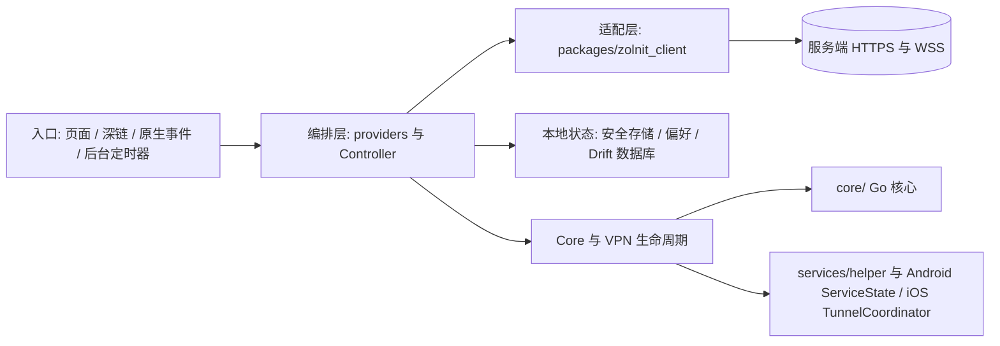

# ZolNit 客户端架构

本文描述 ZolNit 在 FlClash 派生代码上的调用路径、状态所有者、失败规则和耦合点。初始基线为 `d0af9d83c4f37199caceb436b3c3ae66cdb36cd6`；收件箱部分补充到已验证的 `7fd40a7a4777047b554a786ea4085ec1d62a0240`。观察日期 2026-11-15；最终发行来源以对应receipt为准。原有 FlClash 的内核与生命周期机制见 [.agents/architecture.md](../../.agents/architecture.md)，本文只补充 ZolNit 特有路径。

## 1. 分层

编排层（[lib/providers/zolnit*.dart](../../lib/providers/)）持有 ZolNit 的 Flutter 侧状态，并决定何时调用适配层、何时改动本地存储、何时请求 Core 变化。适配层（[packages/zolnit_client/lib/](../../packages/zolnit_client/lib/)）不依赖 Flutter 的 widget 层，包含 HTTP/协议校验、纯领域控制器和存储接口，不仅是 HTTP 包装器；因此可以在 `packages/zolnit_client` 的测试中独立运行。

## 2. 状态所有者

| 领域 | 唯一所有者 | 被动参与者 | 持久化 | 关键文件 |
|---|---|---|---|---|
| 登录会话与代际 | `ZolnitSessionController` | 页面只读快照；`api.generation` 随代际变化 | 安全存储键 `zolnit.session.authorization.v1` | [session.dart](../../packages/zolnit_client/lib/src/session.dart)，[session_vault.dart](../../packages/zolnit_client/lib/src/session_vault.dart)，[providers/zolnit_vault.dart](../../lib/providers/zolnit_vault.dart) |
| 订阅 bundle 同步 | `zolnitSyncCurrentClientBundleProvider` 所在的同步器（版本号递增） | 路由与配置写入读取同一结果 | Drift profile 与配置文件 | [providers/zolnit_bundle.dart](../../lib/providers/zolnit_bundle.dart) |
| 路由状态 | `ZolnitRouting` | 探测调度器与健康缓存 | 内存 | [providers/zolnit_routing.dart](../../lib/providers/zolnit_routing.dart) |
| 支付动作 | `CheckoutController` | 页面提交动作，只显示服务端状态 | 无；同意条款仅在进程内记录 | [checkout.dart](../../packages/zolnit_client/lib/src/checkout.dart)，[billing_api.dart](../../packages/zolnit_client/lib/src/billing_api.dart) |
| 实时传输 | `ZolnitRealtimeChannel` | 页面转交连接健康与事件，不另建传输状态 | 偏好存储中的游标与去重集合 | [realtime.dart](../../packages/zolnit_client/lib/src/realtime.dart) |
| 收件箱协调 | `ZolnitInboxCoordinator` | Home只拥有弹窗队列/路由/呈现；store负责串行持久化 | 原偏好格式不变；待展示合并记录仅在当前会话内存 | [inbox_coordinator.dart](../../lib/common/inbox_coordinator.dart)、[zolnit_realtime.dart](../../lib/providers/zolnit_realtime.dart) |
| 礼品卡兑换 | `ZolnitGiftCardAttempt` | 偏好存储负责持久化与串行写入 | 偏好存储（按卡号哈希与请求 ID） | [rewards.dart](../../packages/zolnit_client/lib/src/rewards.dart)，[providers/zolnit_rewards.dart](../../lib/providers/zolnit_rewards.dart) |
| Android VPN | `ServiceState`（外观）→`ServiceStateMachine`（裁决） | Flutter 的 `ServicePlugin` 发送带版本号的乐观命令；`AndroidServiceStateHost` 只报告真实宿主结果 | 无（内存中的 `RunIntentArbiter` 令牌） | [ServiceState.kt](../../android/app/src/main/kotlin/com/zolmid/zolnit/ServiceState.kt)，[ServiceStateMachine.kt](../../android/app/src/main/kotlin/com/zolmid/zolnit/ServiceStateMachine.kt) |
| iOS 显式启停意图 | `TunnelIntentAuthority` 裁决；Runner `TunnelCoordinator` 与 Shared `TunnelIntentClient` 执行及观察 | Flutter、快捷动作、AppIntent/Widget 通过共同 token 裁决；实际隧道状态仍由 OS 报告 | App Group 共享容器（[PacketTunnelSharedStateStore.swift](../../ios/NECore/PacketTunnelSharedStateStore.swift)） | [TunnelCoordinator.swift](../../ios/Runner/Tunnel/TunnelCoordinator.swift)，[WidgetSharedState.swift](../../ios/Widget/WidgetSharedState.swift) |
| 启动守护 | `BootGuard` | `Bootstrap._initData` 在迁移之后、容器创建之前求值一次 | 偏好存储的 `BootRecord`（JSON） | [boot_guard.dart](../../lib/common/boot_guard.dart)，[boot_record.dart](../../lib/common/boot_record.dart)，[bootstrap.dart](../../lib/bootstrap.dart) |
| Windows 特权操作 | `ZolNitHelperService`（Windows 服务） | `services/helper` 的 `service::windows` 模块通过 SCM 分发；应用通过本地 HTTP/TCP 动态端口请求，并由 Helper 校验连接进程的 SID | 无；仅服务控制管理器（SCM）持有注册状态 | [windows.rs](../../services/helper/src/service/windows.rs) |
| 桌面 Core | `DesktopCoreLifecycle` | RPC 客户端只转发请求 | 无 | [lifecycle.dart](../../lib/core/desktop/lifecycle.dart)，[rpc_client.dart](../../lib/core/desktop/rpc_client.dart) |

## 3. 入口到存储的完整路径

### 3.1 账户登录与会话恢复

1. 入口：[views/zolnit/auth.dart](../../lib/views/zolnit/auth.dart) 提交账号与密码。
2. 编排：`ZolnitSessionController` 在登录前递增代际，丢弃旧代际的回调。
3. 适配：`XboardClient` 调用 `passport/auth/login`，返回的 `auth_data` 已带 Bearer 前缀（[README](../../packages/zolnit_client/README.md)）。
4. 存储：令牌写入安全存储；密码不持久保存。
5. 恢复：启动时从安全存储读取、校验，再同步账户所属订阅。网络错误保留令牌以便重试；关闭客户端不执行退出。
6. 退出与失效：`deleteAuthorization` 先执行 `beforeDelete` 回调，最多等待 3 秒，然后删除安全存储键。
7. 测试：`test/providers/zolnit_vault_test.dart` 中的 `native retirement starts even while credential deletion waits`；`test/views/zolnit/auth_restore_test.dart` 中的 `pending automatic restore cannot disable sign-in`。

### 3.2 订阅 v2 签名与 bundle v1 对象

订阅有两条路径，读取时要先区分版本：

- **签名信封（v2）**：[signed_subscription.dart](../../packages/zolnit_client/lib/src/signed_subscription.dart) 校验 `zolnit-client-subscription-v2`，使用 Ed25519。允许的 `kind` 为 `bundle`、`revoked`、`state`。公钥来自随 Core 打包的 trust 资源的 `public_key_map`。空的或畸形的 trust 文件不产生任何公钥，所有签名都会失败关闭（fail closed）。
- **bundle 对象（v1）**：[client_bundle.dart](../../packages/zolnit_client/lib/src/client_bundle.dart) 的 `ZolnitClientBundle.parse` 检查 `connection` 与 `routing` 两段的 SHA-256 摘要。摘要不一致即拒绝。

bundle 的 TTL 与撤销：bundle 中的过期时间由 `_timestamp` 解析，过期的 bundle 不写入 profile。`revoked` 信封携带 `reason`，由 verifier/`ZolnitSignedSubscriptions` 按独立 kind 校验和处理，不会被当成 `bundle` 写入。

测试：`packages/zolnit_client/test/signed_subscription_test.dart` 中的 `production empty trust map and tampering fail closed`、`v2 capability never gates legacy or third-party subscriptions`；`test/providers/zolnit_signed_subscription_test.dart` 中的 `session invalidation and logout carry the observed intent`。

### 3.3 路由与返回路由

- 路由：`ZolnitRouting` 持有状态。探测由 [routing_probe_scheduler.dart](../../packages/zolnit_client/lib/src/routing_probe_scheduler.dart) 调度：活动间隔 30 秒，空闲间隔 60 秒，结果缓存 30 秒。健康记录由 [routing_provider_health.dart](../../packages/zolnit_client/lib/src/routing_provider_health.dart) 保留 90 秒。
- 返回路由：Go 侧 [core/clientbundle/return_route.go](../../core/clientbundle/return_route.go) 与 Dart 侧 [common/zolnit_return_route.dart](../../lib/common/zolnit_return_route.dart)、[providers/zolnit_return_route.dart](../../lib/providers/zolnit_return_route.dart) 同时存在。它描述的是“返回路由的分派绑定”，即哪个 Core 分组被激活，不是支付返回。
- 测试：`test/common/zolnit_return_route_test.dart` 中的 `explicit dispatch bindings start local and observe both Core parents`（本地分派绑定与两个 Core 父组）。它不覆盖支付返回，支付返回见第 3.5 节。

### 3.4 实时消息：WebSocket、重连与 HTTP 读取

- 连接：`_open` 检查生产环境的源地址只能是 `https://link.zolmid.com`，先请求票据 `/api/v1/zolnit/client/realtime/ticket`，再用票据连接 `wss://link.zolmid.com/realtime/v1/socket`。
- 超时：打开过程整体 20 秒（`_watch`）；发送 hello 后等待 ready 为 30 秒；ready/pulse 后存活期限默认 150 秒，RPC 默认 8 秒；ping 每 35 秒，若没有 pong 则失败；`resync` 的回调最多 22 秒；`WebSocket.connect` 超时 12 秒，HttpClient 连接超时 8 秒（[realtime.dart](../../packages/zolnit_client/lib/src/realtime.dart)）。
- 失败：`_fail(epoch)` 关闭套接字，取消 pending 请求，并在前台时安排重连。重连指数退避：`_attempt` 上限 8，延迟为 `min(180, 2^attempt)` 秒乘以 0.75 到 1.25 的抖动。
- 读取回退位于 [api.dart](../../packages/zolnit_client/lib/src/api.dart) 的 `XboardClient._preferLive<T>(method, data, parse, http)`：只有当前代际的 `liveReads` 支持该方法时才尝试 WS。等待结束后先检查客户端是否关闭、账号代际是否变化；变化就抛 `superseded`，**不执行旧请求的 HTTP 回退**。代际仍有效且 WS 返回 null 或无法解析时，才调用对应普通 REST 的 `http()` 回调。HTTP 仍可能返回业务/网络错误。
- `supports` 受通道健康、已协商方法集合和 `_untilPulse` 约束。`unsupported` 只从当前方法集合移除；连接释放清空集合，后续 `ready` 帧可重新协商，不是永久禁用。其他暂时失败可等下一次 pulse 后重试 WS。`realtimeInbox`、`notices`、设备状态、`orderStatus`、`fetchSignedSubscriptionState` 使用这条读取路径。
- `inbox.read` 是另一条写动作：`ZolnitInboxCoordinator.markRead` 先通过注入的实时通道尝试 `markInboxRead`，完成后重核页面/账号代际；只有仍有效且 WS 未完成时，才调用 `markRealtimeInboxRead` 的 HTTP POST。不能把它归到通用 `_preferLive`，也不能把 WS method 名当成 REST URL。
- 绑定与释放（disposal）：`ZolnitRealtimeChannel` 在收到 `ready` 帧后调用 `api.attachLiveReads(this, _apiGeneration)`（由 `ready` 帧处理分支完成）；在 `dispose()` 中调用 `api.detachLiveReads(this)`（第 224 行附近）。`XboardClient.liveReads` 这个 getter 还会额外检查 `_liveGeneration == _generation`，账户切换后旧代际的通道即使没有显式 detach 也不会被当作可用的实时源。
- 退避：`_fail(epoch)` 关闭套接字、拒绝 pending 请求，并在前台时安排重连；`_attempt` 上限 8，延迟 `min(180, 2^attempt)` 秒乘 0.75–1.25 的抖动。退避期间的每一次 `_preferLive` 调用都直接落到 HTTP；通道是否可用还受代际与健康检查约束。

测试：`test/views/zolnit/realtime_withdraw_test.dart` 的三个 `test(` 用例，以及 `test/views/zolnit/realtime_home_test.dart`。

### 收件箱快照与展示提交

收件箱的 `refresh/invalidate/withdraw/markRead`、同代请求合并、未读计数和自动已读重试统一在 `ZolnitInboxCoordinator`。账号代际来自会话所有者，snapshot epoch用于重连/resync失效；两者不能互相替代。Home仍处理弹窗导航和呈现顺序，但不直接决定持久化快照的有效性。

存储在排队执行及实际提交之前检查当前性。已经进入平台 `setString` 的写入无法撤回：若随后发生同账号重连，协调器保留当前会话的 `_pendingPresentation`，下一份有效快照与已存内容核对后才消费，保证保留公告只弹一次、编辑更新原弹窗、撤回/已读不弹。账号变化和dispose清理这份内存记录；它不是新增持久schema。旧账号已经开始的写入至多在原账号scope完成，不能变成新账号展示。

验证入口为 `test/views/zolnit/inbox_coordinator_test.dart` 与 `realtime_home_test.dart` 的阻塞存储场景。关键反例是在**平台写入已开始之后**使快照失效，不是只让HTTP回包迟到。覆盖保留、撤回、编辑、重复resync、已关闭的未读弹窗及历史已读/未读，防止以“存储 unchanged”丢失尚未展示的变化。

### 3.5 支付与付款确认

- 入口：[views/zolnit/cashier.dart](../../lib/views/zolnit/cashier.dart) 调用 `CheckoutController`。Hosted 收银台在系统浏览器打开。
- 确认：`status(tradeNo)` 的结果决定界面。只有订单状态 3 才显示完成。状态 1 为开通中，4 为折抵，两者都不是完成。
- 未知结果：超时、408 与 5xx 错误记为 `payment_status_unknown`，不会自动视为失败或成功。
- 轮询：`poll` 默认每 3 秒一次，共 40 次，允许 1 到 100 次之间的范围。
- 支付返回链接：`zolnit://safepay` 由 [common/link.dart](../../lib/common/link.dart) 的 `isPaymentReturnLink` 识别，回调在 [application.dart](../../lib/application.dart) 第 134 行附近调用 `session.refreshPayment()`。回调只刷新状态，不授予权益。
- 测试：`test/views/zolnit/cashier_test.dart` 的 `awaiting payment keeps retry and cancellation available` 与 `terminal order $status removes payment controls`。

### 3.6 礼品卡与幂等

- 入口：[views/zolnit/rewards.dart](../../lib/views/zolnit/rewards.dart) 提交兑换码。
- 幂等键：`ZolnitGiftCardAttempt` 持有请求 ID（由兑换流程生成并随未完成 attempt 持久化），并通过 `Idempotency-Key` 请求头发送。键的格式必须匹配 `^[A-Za-z0-9_-]{8,128}$`，否则抛出 `invalid_idempotency_key`（[rewards.dart](../../packages/zolnit_client/lib/src/rewards.dart)）。
- 持久化：`write(cardHash, requestId)` 与 `remove(cardHash, requestId)` 由 `ZolnitGiftPreferencesStore` 串行执行，因此同一卡号的未完成请求在重启后仍可恢复。
- 测试：`test/views/zolnit/rewards_recovery_test.dart`（一个 `test(` 用例）与 `test/views/zolnit/rewards_test.dart`。

### 3.7 原生界面

入口与原生视图的关系见 [platform-contracts.md](platform-contracts.md) 第 5 节。简述：`ZolnitNativeHome` 在 `ZOLNIT_NATIVE_UI` 编译参数为真时才创建 `NativeUiBridge`；`publishSnapshot` 把快照发送到平台视图；原生命令回到 Dart 后由 `_command` 校验 `accountGeneration`，过期命令返回 `stale_account`，安全模式返回 `safe_mode`，未登录返回 `unauthenticated`。

### 3.8 Android VPN 服务控制链

Flutter 到真实 VPN 进程之间有三层，职责各不相同：

1. `ServicePlugin.kt`（[ServicePlugin.kt](../../android/app/src/main/kotlin/com/zolmid/zolnit/plugins/ServicePlugin.kt)）是 MethodChannel 外观，把 `start`、`stop`、`syncState`、`getActiveVpnOptions` 等调用转给 `ServiceState`；它还单独开了一条用 `makeBackgroundTaskQueue()` 的 `coreChannel`，让 Core 相关调用不阻塞主线程。
2. `ServiceState`（[ServiceState.kt](../../android/app/src/main/kotlin/com/zolmid/zolnit/ServiceState.kt)）是薄外观，所有方法直接转发给内部的 `ServiceStateMachine`，并额外持有 `attachFlutterEngine`/`detachFlutterEngine`。
3. `ServiceStateMachine`（[ServiceStateMachine.kt](../../android/app/src/main/kotlin/com/zolmid/zolnit/ServiceStateMachine.kt)）是唯一裁决者：`runState` 由 `publish()` 从“最新意图、正在进行的转换、宿主实际运行的结果”三者推导，任何调用路径都不能单独把它标记为某个值。`RunIntentArbiter` 发出的 `RunRequest` 令牌贯穿一次启动/停止请求；`handleServiceLost(token)` 只在传入令牌仍是当前令牌时才把状态回落到 `STOPPED` 并调用 `host.notifyStopped()`——即使服务已经丢失，一个更新的启动请求也不会被这次回调覆盖。`handleToggleAction` 按 `isRunRequested`（来自 `arbiter.isRunningRequested`）决定转发到 `handleStartAction` 还是 `handleStopAction`。

这三层与第 2 节表格中“Android VPN”行是同一所有者链；UI 与磁贴、小部件、Intent（见 [platform-contracts.md](platform-contracts.md) 第 7 节）都只能通过 `ServicePlugin`/`ServiceState` 这一入口请求转换，不能绕过 `ServiceStateMachine` 直接操作底层服务。

### 3.9 iOS 隧道、Widget 与共享状态

[Shared Intent](../../ios/Shared/Intent.swift) 与 Widget 经 `NEHelper` 发起操作；Flutter 与 Runner 快捷动作经 `TunnelCoordinator`。两个执行路径共用 [TunnelIntentAuthority.swift](../../ios/Shared/TunnelIntentAuthority.swift)，不靠 Runner 的进程内 generation 推断跨进程一致性。[TunnelIntentClient.swift](../../ios/Shared/TunnelIntentClient.swift) 管理 Shared 请求与连接观察生命周期。

C 已集成的实现（原写手提交 `f56261c89300a7792caeb7ba96f45882583a6abd`）在 Shared 引入 `TunnelIntentAuthority` / `TunnelIntentClient`，与 Runner 协调器配合。短期 authority/effect 文件锁与 owner FD 活性锁分离：活 owner 才使 pending 生效；终态、取消或被更新意图替代时释放所有权。终态通知在连接专属观察器中同步锁存，并以连接身份和请求 token 防止旧回调生效；轮询保留用于静默状态和远端失效。锁忙时可能留下磁盘 pending 残留，但无活 owner 即不参与 toggle。

Runner、Shared 和冷启动 ServiceChannel 首次注册仅对 busy 有界重试，最多 20 次异步等待各 50ms（另有调度/I/O 时间）；取消、新的本地尝试或外部已接受 token 均阻止旧重试胜出。已接受队列 token 消费时不得重新注册；无固定 30 秒过期，也不对偏好/确认等待套用注册超时。独立复审、原反例对照和完整 Runner 无签名编译已通过；真实 OS/设备/VPN 行为仍须 V3，见 [验证基线](verification-baseline.md)。

- 源码 entitlement 与发行投影要分开：d0 的 Runner 声明自身 Keychain 组，NECore/Widget 源文件没有 Keychain 组；但 Apple 工具 pin `97f29774` 的 `source_preparation.py` 会给 Runner/NECore 投影共同的 renewal Keychain 组及 Info 配置。`ios/Shared/ClientBundleRenewalConfiguration.swift` 和 `ClientBundleKeychainStore.swift` 使用该明确 access group 保存按 session epoch 绑定的续期凭据；Widget 被配置解析器排除。共享状态快照/epoch 另用 App Group。不能从未投影源码推断发行包没有跨 Runner/NECore 续期能力，也不能把 renewal 记录与 Flutter 默认会话存储混为一项。见 [平台契约](platform-contracts.md) 第 3 节。

### 3.10 Windows 身份与 Helper 的 SCM 边界

- 进程级身份：`windows/runner/main.cpp` 在 `wWinMain` 开头调用 `SetCurrentProcessExplicitAppUserModelID`，`_DEBUG` 构建写入 `com.zolmid.zolnit.debug`，否则写入 `com.zolmid.zolnit`（第 19–23 行）。这一步只影响任务栏分组与通知来源的 AUMID，不改变安装路径或数据目录。
- 单实例与清理：同一文件中 `WindowPluginFindRunningWindow()` 检测到已运行实例时，新进程只转发深链（`SendAppLink`）并激活窗口；`--remove-user-registrations` 与 `--clear-stale-proxy` 是卸载与异常退出后的清理入口，分别调用 `autostart::RemoveOriginalUserTask` 与 `ProxyPluginClearStaleProxy`/向已运行窗口发送 `PROXY_PLUGIN_RELEASE_PROXY_MESSAGE`。
- Helper 的安装和运行有不同入口：[system.dart](../../lib/common/system.dart) 的 `registerHelperService` 先查 readiness；需要安装时，`registerService` 通过 `runas` 请求提权运行 `install --owner-pid <当前进程>`，随后等待服务就绪。安装程序的 `install_service` 解析所属用户 SID，调用 SCM 创建/启动 `ZolNitHelperService`；`Run` 的 `service_dispatcher::start` 则连接 SCM 分发 `service_main` 和控制事件，不是注册动作。已运行 Helper 在 loopback 动态 TCP 端口提供 HTTP 接口，经注册表公布端口并核对连接进程 SID（`services/helper/src/service/peer.rs`）。桌面 Core 的命名管道 IPC 是另一条链路。应用可以发起提权安装，但不能把界面状态当成服务或 Core 已运行的证明。

### 3.11 启动守护、迁移与数据恢复

- 迁代顺序：`Bootstrap._initData`（[bootstrap.dart](../../lib/bootstrap.dart)）先调用 `migration.run()` 完成偏好/配置迁移，再调用 `bootGuard.evaluate(profileId: config.currentProfileId)`；只有在这一步之后才会创建 `ProviderContainer`，因此启动守护看到的 `currentProfileId` 已经是迁移后的值。
- 判定逻辑（[boot_record.dart](../../lib/common/boot_record.dart) 的 `resolveBootDecision`）：只有上一条记录的 `stage` 还停在 `starting`（即上次没有正常走到 `markRunning`/`markClosed`）才会判定为异常；若能匹配到一条更晚的 `AppExitInfo` 且其 `reason.isExternalStop`（用户主动退出、被系统杀死等），则不计入失败次数。否则失败计数加一，达到 `crashRecoveryClearThreshold = 2` 且存在 `profileId` 时，`recovery` 置为 `clearProfile`（清空当前 profile 的 id，下次不自动连接该配置）；未达阈值时置为 `skipAutoSetup`（本次跳过自动连接，但保留 profile）。
- 落地：`_initData` 在 `_bootDecision.recovery == BootRecovery.clearProfile` 时把 `config.currentProfileId` 置空并保存；`_initApp`（同文件）只有在 `!_bootDecision.isDegraded` 时才调用 `setupActionProvider.initStatus(allowAutoRun: ...)`，随后无论降级与否都调用 `bootGuard.markRunning()`。进程正常结束时由 [providers/actions/system.dart](../../lib/providers/actions/system.dart) 第 67 行附近调用 `bootGuard.markClosed()`。
- 支持平台：`BootGuard` 的 `_supported` 默认是 `system.isAndroid`；非 Android 平台的 `evaluate`/`markRunning`/`markClosed` 直接返回，不读写 `BootRecord`。
- 测试：`test/common/boot_guard_test.dart`（`an interrupted launch is carried into the next boot record`、`clearing the profile also drops it from the new boot record`、`a consumed exit timestamp is remembered across launches`、`a completed launch resets the failure count`、`a degraded launch keeps its failure count until a clean run`、`a clean exit closes the record and clears the failure count`、`markRunning and markClosed do nothing without a record`、`an unsupported platform never reads, writes or recovers`）与 `test/common/boot_record_test.dart`（纯函数 `resolveBootDecision` 的分支）。
- 备份与恢复（[backup.dart](../../lib/common/backup.dart)）：`writeBackupArchive` 把 `configMap`（JSON）、Drift 数据库快照与 [BackupEntries.of](../../lib/common/backup.dart) 列出的 profile/脚本/非远程 provider 文件一起打进一个 zip；远程 provider 的缓存由 Core 在恢复后重新下载，不进归档。`readBackupArchive` 先解压到 `stagingDirPath`，再读取其中的 `configJsonName`；`version > Migration.currentVersion` 或数据库的 `schemaVersion` 超过当前 `Database.schemaVersion`（21，[database.dart](../../lib/database/database.dart) 第 53 行）都会抛出 `BackupException(BackupFailure.newerVersion)`，即拒绝导入比当前版本更新的备份。`version == 0` 的旧归档走 `migrateLegacyConfig`。
- 路径安全：`_stagedEntryPath` 显式拒绝以 `../` 开头、规整后等于 `..`、或规整后是绝对路径的归档条目名，并在写入后用 `isWithin(stagingDirPath, outPath)` 二次确认，防止一个被篡改的归档写到 `stagingDirPath` 之外（源码注释称这是“对不受信输入的处理”）。
- 测试：`test/common/backup_task_test.dart`（`the archive carries the database, the config and only the listed ...`、`restoring returns the rows and stages the files`、`a version 0 archive goes through the legacy migration`、`an archive without a config document is rejected`、`a file that is not a zip archive is rejected`、`a config from a newer data version is rejected`、`a database from a newer schema is rejected`、`an archive without a database yields just the config`）；数据库迁移段另见 `test/database/migration_v1_to_v2_test.dart`。

### 3.12 更新清单校验与安装身份

- 网站清单与 GitHub 发布清单的解析、资产 URL/版本号正则校验在 [app_update.dart](../../lib/common/app_update.dart)：`_validAsset` 要求资产名匹配 `^ZolNit-[A-Za-z0-9._+\\-]+$`、`sha256` 匹配 64 位十六进制、URL 必须为 HTTPS/443、无 userinfo/query/fragment，host 固定为 `link.zolmid.com`、路径固定为 `client/downloads/<version>/<name>`，并要求资产名以 `ZolNit-<去掉前导 v 的版本号>-` 开头；任一条件不满足时 `_validAsset` 返回 false，`ReleaseAsset.parse` 不接收该资产。`_validVersion` 只接受 `v<int>.<int>.<int>` 形式且每段不超过 `int32` 最大值。
- 目标包识别（`detectUpdateTarget`）按操作系统与 `Abi.current()` 推断 `UpdatePackage`：iOS 只有在 `ClientPaymentPolicy.fromEnvironment().distribution == direct` 时才返回 `iosDirect`，否则 `unsupported`（iOS App Store 渠道没有应用内更新，只能走商店）；桌面平台通过可执行文件所在目录是否存在 `config`（portable）或 `unins000.exe`（Windows 安装版）、`APPIMAGE` 环境变量，以及 `dpkg -S`/`rpm -qf`/`pacman -Qo` 反查包管理器归属（`findLinuxPackageOwner`）来区分安装形态。
- 测试：`test/views/zolnit/update_test.dart`（见 [testing-and-debugging.md](testing-and-debugging.md) R8）。

### 3.13 网页会话、工单、公告与定时更新

网页 SSO 不以 App 深链回跳作为必要步骤。首页 `_website` 和更新页面调用 `ZolnitWebSessionCoordinator`；仅已登录、第一方 origin 和固定 destination 才请求一次性授权码。浏览器打开 `https://link.zolmid.com/theme/ZolNit/app-login.html` 完成网页会话消费。Android/iOS/macOS/Linux 使用 `com.zolmid.zolnit/web_session` 原生通道；Windows 使用临时 WebView2 profile 和受限导航。重复 open 合并，账号变化/取消使 epoch 失效并关闭浏览器；18 秒未完成则关闭，仍为当前账号时可用不携带授权码的普通 fallback。不能把登录 token 拼进 URL 或借此复制用户浏览器 cookie。

首页 `_openHelp` 已连接 `ZolnitHelpPage`。页面读取知识库和工单列表，通过 `ZolnitSupportClient` 创建/回复/查看详情；请求完成后检查账号代际和 mounted。旧文档“独立工单页面未接入”的说法不再适用于当前首页。独立每日流量明细 API 仍在包中，但检查的生产视图未见对应独立页面；`data.dart` 是展示格式化与错误文案辅助函数。

首页 `_openNotices` 合并 session 公告和账号作用域收件箱，传入修订/代际检查；失效时弹窗关闭，撤回与已读状态不能由旧账号回调重新写回。测试入口为 `realtime_home_test.dart` 与 `realtime_withdraw_test.dart`。

通用配置的 `ProfileAutoUpdater` 按各 profile 的实际 autoUpdate 开关和间隔排程；最近成功或尝试时间决定下一次到期，失败也推进尝试时间以避免紧循环。`_running` 防止重叠检查，dispose 取消定时器。这个上游共享能力仍保留，隐藏配置页不等于可以删掉它。

## 4. 错误、取消、超时与重试规则

| 场景 | 规则 | 依据 |
|---|---|---|
| 账户切换 | 旧代际的所有异步回调在完成后检查代际，不匹配则丢弃 | `_nativeGeneration`，`ZolnitSessionController` |
| 启动恢复失败 | 网络错误保留令牌，不执行退出 | 第 3.1 节 |
| 安全存储删除 | 删除前的回调最多 3 秒，超时后仍删除 | `deleteAuthorization` |
| 实时打开 | 打开阶段 20 秒；退避基准最多 180 秒，乘 0.75–1.25 抖动 | [realtime.dart](../../packages/zolnit_client/lib/src/realtime.dart) |
| 支付状态 | 未知结果不自动重试付款；只查询状态 | `payment_status_unknown` |
| 支付轮询 | 默认 40 次，每次 3 秒 | `poll` |
| 礼品卡 | 同一请求 ID 重试；键格式不合法直接拒绝 | `ZolnitGiftCardAttempt` |
| 路由探测 | 活动 30 秒、空闲 60 秒、缓存 30 秒 | `routing_probe_scheduler.dart` |
| 订阅 bundle | 摘要不符或过期即拒绝；撤销信封不写入 profile | `client_bundle.dart`，`signed_subscriptions.dart` |

## 5. 耦合点与临时适配

| 耦合 | 位置 | 性质 | 移除条件 |
|---|---|---|---|
| 返回路由跨 Dart/Go 的合同 | [common/zolnit_return_route.dart](../../lib/common/zolnit_return_route.dart) 与 [core/clientbundle/return_route.go](../../core/clientbundle/return_route.go) | 不同运行时的对应逻辑，需保持合同一致 | 用共享测试向量核对；不预设应合并为一份运行时实现 |
| 公共层直接依赖 ZolNit 客户端 | [common/zolnit_return_route.dart](../../lib/common/zolnit_return_route.dart) 导入 `zolnit_client` | 通用目录依赖产品包 | 把返回路由的纯数据部分移入子包 |
| 原生视图未挂载 | [views/zolnit/native_home.dart](../../lib/views/zolnit/native_home.dart) 当前生产首页不挂载，仅测试构造 | 已实现组件，当前入口休眠 | 有明确的挂载决定后，把 `ZolnitNativeHome` 接入 `home.dart` 或 `shell.dart` |
| 合同与实现的同步 | [native_ui/contract.v1.json](../../native_ui/contract.v1.json) | 尚未确认自动生成链路 | 先调查实际消费者，再决定是否需要补合同检查 |
| 代际与 Core 的时序 | [providers/zolnit.dart](../../lib/providers/zolnit.dart) 与 [providers/zolnit_connection.dart](../../lib/providers/zolnit_connection.dart) | 产品层请求 Core 变化，Core 层裁决 | 不属于临时适配，保留为边界 |

## 6. 产品、上游与适配的边界

- 产品：[lib/views/zolnit](../../lib/views/zolnit/)、[lib/providers/zolnit*.dart](../../lib/providers/)、[packages/zolnit_client](../../packages/zolnit_client/)、[plugins/zolnit_native_ui](../../plugins/zolnit_native_ui/)。
- 上游：[core/](../../core/)（其中 `Clash.Meta` 为固定 gitlink）、[lib/core/](../../lib/core/)、[plugins/setup](../../plugins/setup/) 与平台生命周期文件。
- 适配：`lib/providers/zolnit_connection.dart` 与 `lib/providers/zolnit_routing.dart` 把产品状态接入上游 Core。它们请求变化，不替代上游所有者。

## 7. 如何修改一个功能：以账户页的新只读字段为例

这是按现有模式走一遍的步骤，不是已经存在的改动。

1. 确认数据来源。若字段来自 `user/info`，在 [packages/zolnit_client/lib/src/account.dart](../../packages/zolnit_client/lib/src/account.dart) 中找到解析函数（同文件中已有对 `user/info` 的解析）。解析失败应抛出 `ClientFailure`，并在测试中覆盖缺字段的情况。
2. 扩展状态。账户快照由 `ZolnitSessionController` 持有。新字段加入快照时，同时更新 `session.dart` 的快照构造与 `native_home.dart` 的 `_snapshot()`（若原生视图也显示该字段）。
3. 页面展示。在 [views/zolnit/account.dart](../../lib/views/zolnit/account.dart) 中读取快照字段。文案写入 ARB，然后运行 `dart run intl_utils:generate`。
4. 测试。包内测试加到 `packages/zolnit_client/test/`（参照 `renewal_state_test.dart` 的写法），页面测试加到 `test/views/zolnit/account_test.dart`。
5. 验证。运行 [development.md](development.md) 第 7 节中对应的两条命令，并记录未运行的平台。

若该字段需要写入 Core 的配置，还必须按 [.agents/setting-changes.md](../../.agents/setting-changes.md) 选择 Update、Apply 或 Restart 路径。账户字段本身不属于这三条路径，不要为了展示而加入 `PatchClashConfig`。

## 8. 未覆盖的范围

第 3.8–3.12 节已经补上更新清单校验、备份恢复、启动守护、Android 服务控制链、iOS 隧道/Widget 与 Windows Helper 的 SCM 边界；以下是仍然没有逐行追踪、且没有在其他章节出现的部分：

- Windows 登录诊断：控制台记录为历史暂停项，本次没有新的复现信息，不声称已修复。
- 网页 SSO 的源码路径已在第 3.13 节核对；各平台真实浏览器会话和设备交互仍属 V3，未由源码阅读认证。
- `lib/views/config/`、`lib/views/dashboard/`、`lib/manager/`、`lib/providers/state/`、`lib/plugins/battery.dart`、`lib/plugins/app.dart`：这些是原有 FlClash 的通用设置与系统状态面，不属于 ZolNit 产品层新增路径，见 [feature-inventory.md](feature-inventory.md) 的“未扫描的范围”。
- Android `ServiceController`/`ServiceStateMachine` 内部的通知与前台服务细节（`startFromPreferences`、`NotificationParams` 的具体展示规则）：本文只追踪到状态裁决与发布，没有逐行核对通知文案与前台服务生命周期回调。
