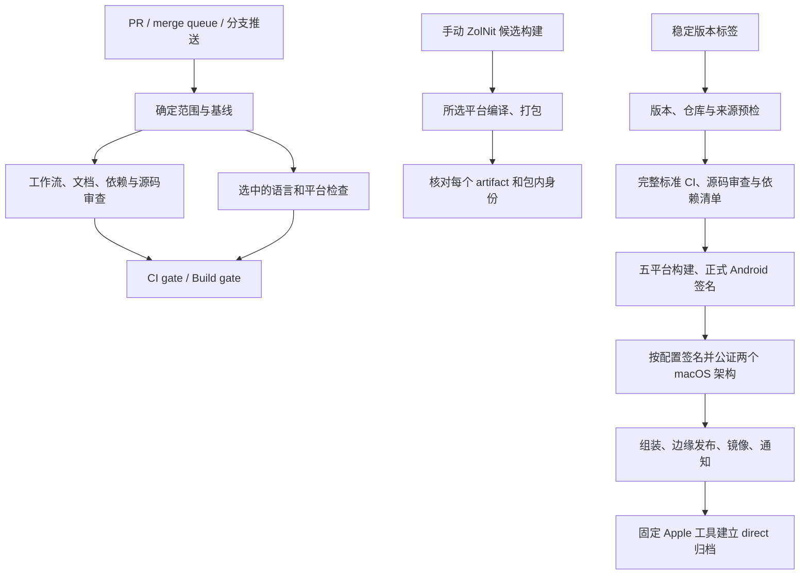

# 从变更审查到正式发行

维护者用 `build.yaml` 审查代码，用 `cloud-build.yml` 取得开发包，用 `client-release.yml` 发布稳定版本。判断一次运行时先固定仓库、事件、源码 SHA、workflow revision、run ID 和 attempt。`main`、产品开发分支和已发布标签可能指向三个不同的提交。



## 1. 触发方式与检查范围

| 事件或用途 | 实际工作 | 在哪里看结果 |
|---|---|---|
| `pull_request` | 验证 GitHub 合并结果。选择器从 PR 基线提交读取，改动用精确提交和 NUL 分隔路径比较。首次采用时基线缺少选择器，执行完整检查。 | PR 的 `CI gate` 及各作业摘要 |
| 普通分支 push | 校验分支头。只有已知、完整且可比较的差异才缩小范围。分支头和 PR 合并提交通常不同，二者各自保留结论。 | `build` 运行的 `Build gate` |
| `merge_group/checks_requested` | 在合并队列组合提交上重新做全量质量检查。 | 合并组的 `CI gate` |
| 手动 `build.yaml` | 全量标准检查与 CycloneDX 清单。选 `deep_review=true` 同时运行全部已配置的 CodeQL 提取器。 | 检查摘要、SARIF 与清单 artifacts |
| 显式 ZolNit 候选 | 手动 `cloud-build.yml`，选择 `ios_source=project`、`build_profile=zolnit`、`android_release=false`。可选全平台或单个平台。 | `Verify manual ZolNit candidate` 的文件/ID/摘要表 |
| 稳定 `vX.Y.Z` 标签 | 正式预检先验证 semver、包版本/构建号、仓库及工作流身份。完整 CI 成功后才能开始带正式签名权限的构建。 | `client-release` 及其同 run 回执 |
| 定时审查 | `security-audit.yml` 每周一 18:19 UTC 在默认分支执行，也可手动运行。重查当前公告数据库，覆盖期间没有提交的依赖。 | 源码清单、SARIF；定时默认分支可将报告发送至 Security 标签页 |

`README.md` 和 `docs/maintenance/` 下的普通 Markdown 是经过确认的轻量路径。维护文档变化仍会执行工作流静态检查和本地链接检查，`main` 上还会验证 changelog。非 main 分支或 PR 仅改 `android/tests/{app,common,service}/…Test.kt` 时可单独运行 Android JVM 检查。其余路径按全量处理，包括 Dart 测试、跨语言接口、构建脚本、锁文件、Core、权限和平台工程。重命名按旧路径与新路径核算。新分支、非快进、超限差异、符号链接及无法可靠解析的历史均保留完整检查或使门禁失败。

门禁核对计划与每个作业的真实结论。选中的检查只接受成功，取消、缺失输出、失败或意外跳过都会使门禁失败。完整 PR 与合并队列在 macOS 作业运行 iOS 续期回归，正式标签在标准 CI 的 Apple 作业运行同一检查，签名构建依赖其成功。同源正式标签的观察器最多等 900 秒，只能复用同一提交和同一次正式运行的七个标准结果，其中包括 Apple 续期。来源不明、缺少检查、API 失败或超时会执行原检查。涉及工作流策略的 PR 应审阅其权限、凭据和选择逻辑。主分支要求 GitHub Actions 的 `CI gate`，该名称用于 PR 和合并队列。普通推送和手动运行使用 `Build gate`。[GitHub 事件说明](https://docs.github.com/en/actions/reference/workflows-and-actions/events-that-trigger-workflows) · [必需状态检查的提交判定](https://docs.github.com/en/pull-requests/collaborating-with-pull-requests/collaborating-on-repositories-with-code-quality-features/troubleshooting-required-status-checks)

## 2. 审查内容与判定

| 层次 | 检查项 | 判定或输出 |
|---|---|---|
| 工作流与文档 | actionlint 检查表达式、事件、依赖、参数与 runner 标签；ShellCheck 检查内嵌 shell 的错误；lychee 离线检查手册和入口 README 的本地链接及锚点。 | 非零即失败。外部网络时好时坏不会影响本地 Markdown 链接门禁。 |
| 供应链 | 工作流和仓库内 composite action 的外部 `uses` 必须使用完整提交 SHA，服务镜像使用摘要。下载的审查工具先验证固定资产摘要再执行。Dependabot 按周集中提出 Actions 更新。 | 审查更新的具体上游提交、工具校验和及所需权限。[GitHub Actions 安全使用指南](https://docs.github.com/en/actions/reference/security/secure-use) |
| Dart / Flutter | 锁定依赖、格式、全量静态分析、生成文件一致性、主测试套件、覆盖率 75% 门槛、本地 plugins、产品包及 setup hooks 专项测试。 | 已跟踪生成结果与固定生成器不一致会失败。只在临时检出内使用既有的测试构建开关。 |
| 原生与 Core | Go 格式、测试、vet、Android 条件编译与隔离网络的路由用例；Rust 格式及锁定依赖的 Helper/插件测试；Windows 服务能力；Android 三个 JVM 模块；三个桌面 Debug 构建。PR/合并队列的 macOS 检查运行 iOS 意图及 SDK 契约。 | Debug 检查覆盖本地插件和宿主编译。五平台产品打包和 iOS 完整 Runner 在 Cloud 矩阵中另验。 |
| 依赖变更 | OSV-Scanner 使用 Git blob 的 Pub、Cargo、Go 和受支持的其它锁文件，对 PR 基线与合并树分别扫描。正式标签按可达、版本较低的最近稳定版本号建立基线。 | 新增的“文件/生态/包/版本/公告”组合阻断。删除、改名和版本替换进入差异。查询异常、缺少输入或报告格式错误均报错。`comparison.json` 定位具体依赖。 |
| 源码审查 | CodeQL 用 `security-extended` 查询 Actions、Python、JS/TS、Ruby、Go、C/C++、Rust、Java/Kotlin。PR 选择相关语言；审查策略变化、合并队列、深度手动与正式调用执行完整配置。Go 和 Android JVM 使用项目工具链实际编译。 | 每种语言产出 SARIF。PR 和正式版本的差异中，主位置位于新增/修改行、`security-severity ≥ 7` 的结果阻断。既有发现、未评分规则及跨文件新调用路径仍须人工阅读报告；扫描工具失败也会阻断相应检查。 |
| 定期 / 正式依赖清单 | 从源码中的受支持清单生成 CycloneDX 1.6 和记录来源提交、输入 Git blob 的 `source.json`。 | 盘点会保留已有公告。它覆盖可解析的依赖元数据，二进制、平台系统库、运行时动态载入和实际可达性需要分别验证。[OSV 输入格式](https://google.github.io/osv-scanner/supported-languages-and-lockfiles/) |

Dart 使用 Flutter analyzer 与项目测试。Swift 的系统入口由真实 SDK 编译、生产算法夹具和候选打包验证。当前固定 Xcode 27.1 使用的 Swift 编译器超出所选 CodeQL Swift 提取器的支持范围。C/C++ 和 Rust 的无构建分析也有生成源码与特定编译条件的覆盖限制。[CodeQL 语言支持](https://codeql.github.com/docs/codeql-overview/supported-languages-and-frameworks/) · [编译语言的分析模式](https://docs.github.com/en/code-security/concepts/code-scanning/codeql/codeql-for-compiled-languages)

每种语言的提取器在各自的 runner 上产生 SARIF。单独的 `Review CodeQL findings` 作业在新的 runner 上直接从 Git 读取判定策略，逐一检查本次 run 和 attempt 中所选语言的报告；缺失、格式错误或出现阻断项都会使检查失败。若只重跑失败作业导致其他语言的报告属于上一 attempt，请选择 **Re-run all jobs**。PR 和合并队列的 Android 工具准备通过 Gradle 官方公开发行地址取得分发包，并核对固定长度及 SHA-256。正式发布和此前使用认证 API 的构建沿用原资产 ID。

## 3. 开发包与正式包

| 产品目标 | 候选包验证重点 | 正式链额外要求 |
|---|---|---|
| Android arm64 | Debug APK、包名/版本/构建号、arm64 原生库与 ELF；有 HTTPDNS SDK 合同的产品分支沿用其校验。 | 发行身份 `com.zolmid.zolnit`、专用密钥、APK 签名报告和正式证书摘要。 |
| iOS arm64 | IPA 的 Runner、NECore、Widget 三个 bundle 身份与版本、SDK、Mach-O 和扩展类型。 | Cloud IPA 是编译依据。正式 direct 归档/设备签名由固定 Apple 工具、environment 和真实设备请求处理。 |
| macOS arm64/x64 | 对照 app bundle、版本、Mach-O CPU、DMG 容器及 SHA256SUMS。 | 按配置使用 Developer ID 签名，分别等待 app/DMG 公证并固定最终字节。 |
| Linux x64 | AppImage ELF、Deb 包名版本/架构、可移植 ZIP；检查声明的文件全集。 | 发布器重新下载正式制品，匹配来源、产品文件摘要与规范名称。 |
| Windows x64 | 安装器和可移植 ZIP、PE 架构、签名盘点报告及实际声明。 | 发行签名状态以签名盘点为准；发布成功本身不授予 Authenticode 身份。 |

候选校验只接受同一 repo、workflow/ref、SHA、run、attempt 和 profile 的预期 artifact。外层摘要、内部 SHA256SUMS、来源字段、工具链和 Core 需一致。缺文件、重复档案、错误版本/架构、混入上一 attempt 或签名类别错误均失败。优先查看失败 target 的 step summary，再选择全量重跑或新建一次 dispatch。正式产物继续由已有 `assemble_release.py`、签名检查点、`publish_release.mjs` 和镜像器独立验证。[正式发布与恢复合同](ci-release-and-recovery.md)

## 4. 使用方法

在工作树中提交修改后即可创建 PR。检查 `Select CI checks`、`Repository review` 和 `CI gate`。SARIF 的 `ruleId`、位置及数据流用于审阅源码。依赖差异先从 `comparison.json` 的 `introduced` 查看对应文件及版本，验证修复范围后再更新锁定版本。

```sh
# 对已推送的分支做完整检查与深度源码审查
REPO=Zolmid/FlClash
BRANCH=codex/your-candidate
gh workflow run build.yaml --repo "$REPO" --ref "$BRANCH" -f deep_review=true

# 编译并核验五个平台的 ZolNit 开发候选
gh workflow run cloud-build.yml --repo "$REPO" --ref "$BRANCH" \
  -f platform=all -f ios_source=project -f build_profile=zolnit -f android_release=false
gh run list --repo "$REPO" --branch "$BRANCH" --limit 8
```

本地可先运行与修改相符的检查。下面的审查工具安装器支持 Linux x86_64 和 macOS arm64，将二进制安装到临时目录。

```sh
BIN=$(mktemp -d)
python3 tool/ci/review_tools.py --bin-dir "$BIN" actionlint shellcheck lychee osv-scanner
export PATH="$BIN:$PATH"
SHELLCHECK_OPTS='--severity=error' actionlint -pyflakes=''
ruby tool/ci/check_action_pins.rb
lychee --offline --include-fragments --no-progress docs/maintenance/*.md README.md README_zh_CN.md
python3 -m unittest discover -s tool/ci/tests -p '*_test.py'
python3 -m unittest discover -s tool/client_release/tests -p '*_test.py'
node --test tool/client_release/tests/*_test.mjs
```

在完整 Git 检出中，将基线和拟审提交的完整 SHA 传给 `python3 tool/ci/dependency_review.py compare --base "$BASE_SHA" --head "$HEAD_SHA" --output "$REPORT_DIR"`。全量清单使用 `inventory --head "$HEAD_SHA" --output "$REPORT_DIR"`。报告记录本次查询时的已知公告；后续数据库更新可使同一提交的结果变化。

正式发行仍从准备好的版本、构建号、changelog 和准确的稳定标签启动。观察 `Formal tag preflight → Standard CI → Release builds → macOS 签名及公证 → Publish`。CI 失败时尚未开始带正式 Android 密钥的构建。必须签名时，签名作业的跳过、取消或失败均阻止进入发布；配置允许跳过时也会核对实际结论。公证 pending 或发布部分成功时，先核对原 run/attempt、检查点、边缘指针及镜像，沿原字节恢复。不要用移动标签或另签一份同名包修复既有版本。

## 5. 成本与维护

一次只改七份维护文档的[既有 main 运行](https://github.com/Zolmid/FlClash/actions/runs/43744468842)耗时 14 分 02 秒，成功作业的运行时间合计 45 分 34 秒。将相同 Git 差异送入新选择器会省去六项标准检查和三套桌面 Debug 编译，这九项在该运行中合计 45 分 23 秒。轻量审查、门禁和 main 的 changelog 检查仍需计时。这个对照是历史作业时长及选择器回放，不是账单或新流程的实测净节省。

候选分支一次只修改本指南的推送实测耗时 22 秒。三个实际运行的作业分别是范围选择、仓库审查和门禁，运行时间合计 26 秒。这个分支样本没有 main 专属的 changelog 检查。同期该分支的 PR 仍对相对于 main 的完整变更进行审查。[纯文档推送](https://github.com/Zolmid/FlClash/actions/runs/45203151544)

全量正式发布采用先检查、后签名构建的顺序，因此全绿时可能比原来的并行启动更慢。节省主要来自文档/独立测试变更缩小范围、PR 按语言选扫描、过期 PR 取消以及失败提交提前停止。请在 Actions 中按 run 与 attempt 记录墙钟耗时、各作业时长和失败阶段，分开比较文档、代码、候选、正式发布四类样本。V3 仍由用户实际使用验收，记为 `USER_WAIVED / NOT_RUN`。

## 6. 怎样判读一次托管验收

首次接入的 PR 在合并结果上跑完八种 CodeQL 分析。独立 runner 收到八份报告，共计 53 条发现，其中 52 条的安全严重度达到 7，本次修改行上命中的阻断项为 0。查看单条发现及调用链时下载对应语言的 SARIF。该次 PR 的 Android、三个桌面 Debug 构建和最终门禁也均通过。[八份报告的判定记录](https://github.com/Zolmid/FlClash/actions/runs/45198323636/job/137784628717) · [PR 门禁](https://github.com/Zolmid/FlClash/actions/runs/45198323636/job/137789094497)

首次五平台候选的 Android、Linux 和 Windows 已生成制品。iOS 和两个 macOS 作业的步骤列表为空，GitHub 的作业注释显示多次分配托管 runner 失败，最终包验证按预期阻断。遇到同样的现象，先查看作业的 **Annotations** 和实际 runner 名称。若作业未取得 runner，保留原 run 记录，在容量恢复后对准确的候选提交重新发起完整 dispatch。若已开始编译，则先定位首个失败步骤。恢复后检查同一次运行的六个目标是否都出现在验证摘要中。[缺少 Apple 产物的实际运行](https://github.com/Zolmid/FlClash/actions/runs/45196341849)
